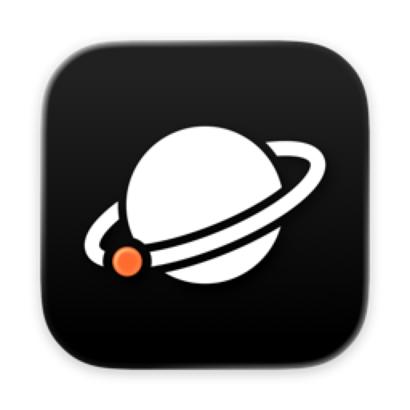
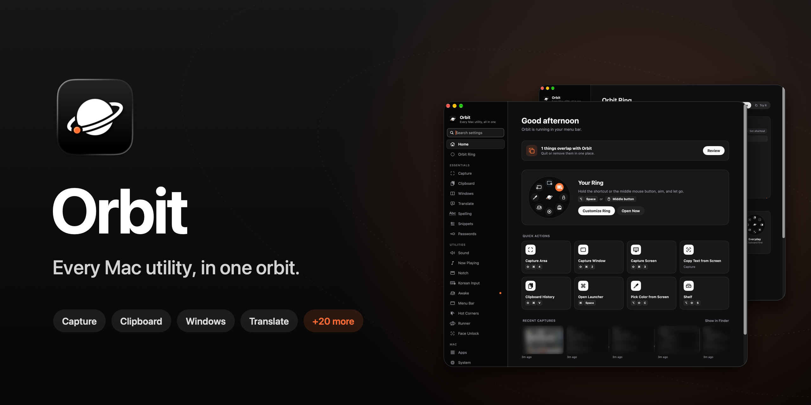
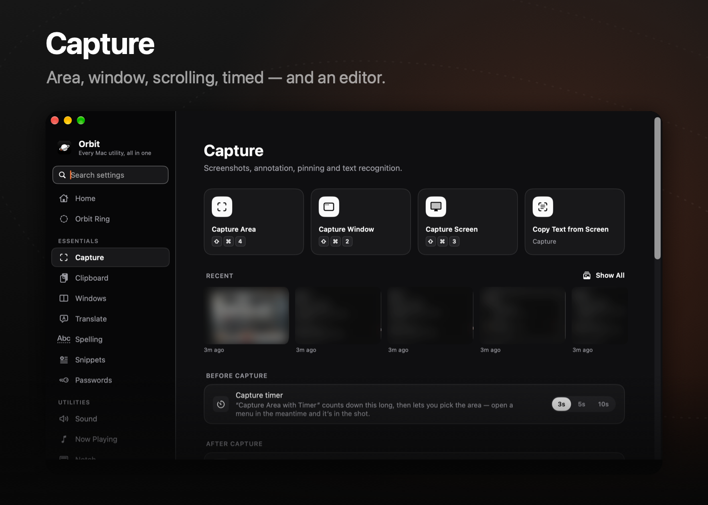
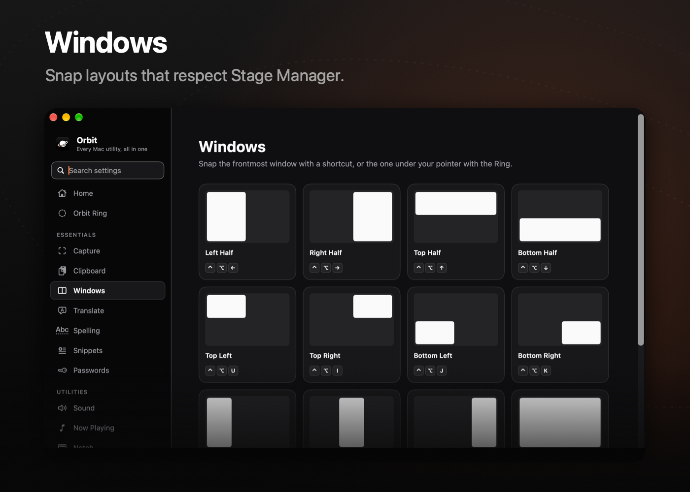
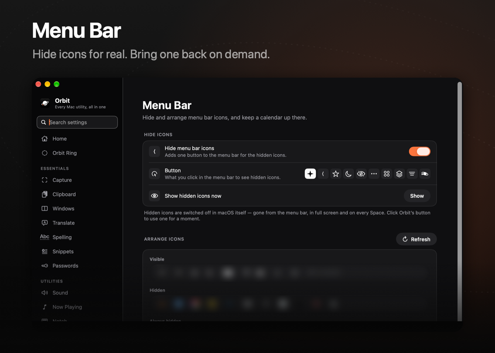
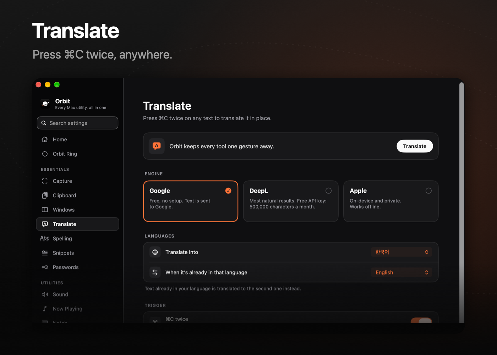
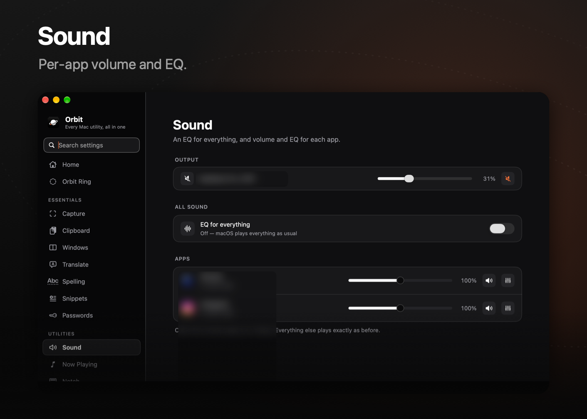
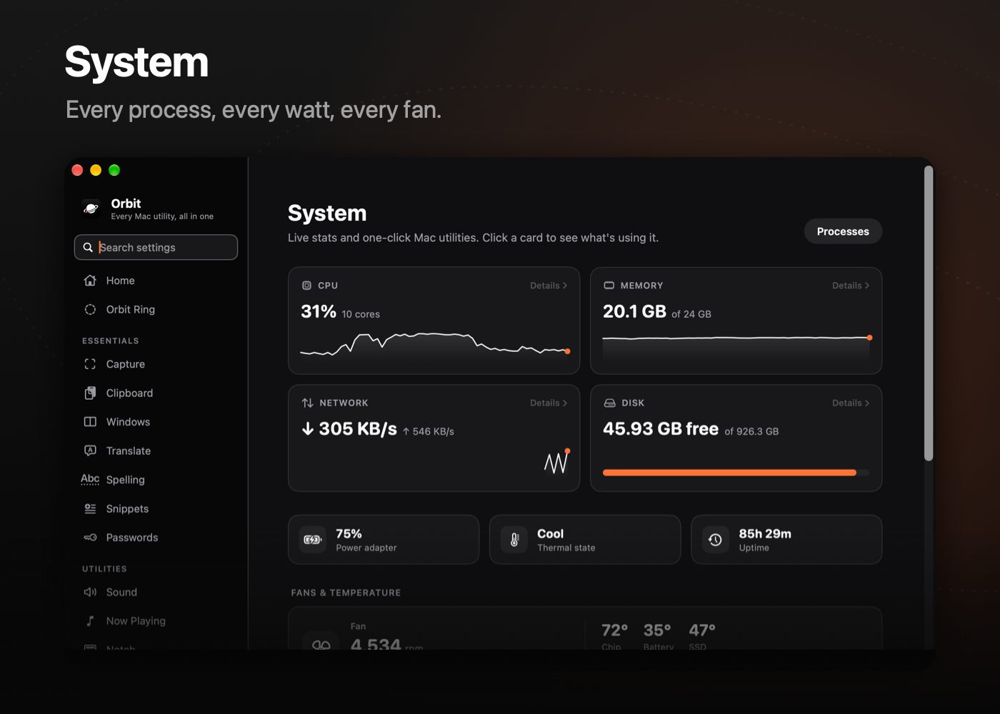

<div align="center">



# Orbit

**맥의 모든 유틸리티 앱을 한 번에**

[](https://github.com/3x-haust/Orbit/releases/latest)
[](#요구-사항)
[](LICENSE)

[**다운로드**](https://github.com/3x-haust/Orbit/releases/latest) · [기능](#기능) · [직접 빌드](#직접-빌드) · [English](README.md)

<br/>



</div>

<br/>

메뉴 막대를 가득 채운 앱 여러 개 대신, 빠르고 가벼운 네이티브 앱 하나. 캡처, 클립보드 기록, 런처, 창 관리, 번역, 메뉴 막대 정리, 잠자기 방지, 앱별 음량, 시스템 모니터까지 — 포인터 주변에 열리는 **링** 하나로 다 꺼내 써요.

검정과 흰색, 그리고 오렌지 한 방울. SwiftUI + AppKit 네이티브, 계정도 서버도 분석도 없어요.

## 기능

<table>
<tr>
<td width="50%"></td>
<td width="50%"></td>
</tr>
<tr>
<td></td>
<td></td>
</tr>
<tr>
<td></td>
<td></td>
</tr>
</table>

### 기본

| | |
|---|---|
| 🪐 **Orbit 링** | 단축키나 마우스 가운데 버튼을 누르면 포인터 주변에 링이 열려요. 3~12칸, 프리셋, 끌어서 편집. |
| 📸 **캡처** | 영역·창·전체·타이머·스크롤 캡처, 클릭 강조가 되는 화면 녹화, 화살표·글자·블러·픽셀화·스포트라이트·돋보기·자·색 추출 편집기, 화면 글자 인식. |
| 📋 **클립보드** | 글자·이미지·파일·색 기록을 검색하고 한 번 눌러 붙여 넣어요. |
| 🪟 **창 관리** | 반쪽·삼분할·사분할·가운데·최대화. 스테이지 매니저와 여러 모니터를 알아서 맞춰요. |
| 🌐 **번역** | 아무 앱에서나 ⌘C 두 번. Google, DeepL(내 키), Apple 중에서 골라요. |
| ✍️ **스니펫** | 줄임말을 치면 전체 문장으로 바뀌어요. |
| 🔐 **비밀번호** | 종단간 암호화 보관함(PBKDF2 + 비밀 키, 항목별 AES-GCM), Touch ID, 보안 점검, 브라우저에서 가져오기. |

### 유틸리티

| | |
|---|---|
| 🔊 **사운드** | 앱별 음량과 EQ, 전체 소리 EQ. |
| 🎵 **지금 재생 중** | 노치에서 앨범 아트와 함께 조작하고, 곡이 바뀌면 배너로 알려줘요. 영상이 나오면 음악을 잠시 멈춰요. |
| ⌨️ **입력** | 한/영 자동 전환, 마우스·트랙패드 스크롤 방향 따로, 키보드 청소 잠금. |
| ☕️ **잠자기 방지** | 시간·시각·앱 실행 동안 — 덮개를 닫아도. |
| ✦ **메뉴 막대** | 아이콘을 진짜로 숨기고(« 없음), 필요할 때 하나만 꺼내요. 메뉴 막대 달력도. |
| 🔲 **핫 코너** | 모서리마다 원하는 동작. |
| 🏃 **러너** | 메뉴 막대의 작은 CPU 애니메이션. |
| 🙂 **얼굴로 잠금 해제** | macOS 암호 창을 얼굴로 채워요. |
| 🗂 **선반** | 노치나 화면 가장자리에서 자라나는 파일 놓는 곳. |

### Mac

| | |
|---|---|
| 🧩 **앱** | 모든 앱을 카테고리별 격자로. |
| 📈 **시스템** | CPU·메모리·GPU·디스크·네트워크·배터리·온도·팬. 카드를 누르면 프로세스별로 자세히. |
| 🖥 **디스플레이** | 외장 모니터 밝기·음량(DDC). |
| 🔋 **배터리** | 충전 한도와 유지 모드. |
| 🧹 **저장 공간** | 무엇이 공간을 차지하는지 보고, 지워도 되는 것만 정리. 앱은 남은 파일까지 삭제. |
| 🗜 **압축** | Zip, 7z 등 — 윈도우에서도 이름이 안 깨져요. 폴더·압축 파일 훑어보기. |

## 설치

1. [최신 릴리즈](https://github.com/3x-haust/Orbit/releases/latest)에서 `Orbit-1.0.0.zip`을 받아요.
2. 압축을 풀고 **Orbit.app**을 `/응용 프로그램`으로 옮겨요.
3. 열면 메뉴 막대에 들어가고, 설정 페이지가 필요한 권한을 안내해요.

Orbit은 GitHub 릴리즈에서 스스로 업데이트해요. **일반 › 업데이트**에서 자동 확인·자동 설치를 켜고 끌 수 있어요.

> [!NOTE]
> 릴리즈는 서명돼 있지만 공증은 받지 않았어요. "개발자를 확인할 수 없다"고 나오면 Orbit.app을 우클릭 › **열기**, 또는 **시스템 설정 › 개인정보 보호 및 보안**에서 허용해 주세요.

모든 데이터는 이 Mac에만 있어요. 네트워크는 고른 번역 엔진과 업데이트 확인에만 써요.

## 요구 사항

- macOS 26 이상
- Apple silicon

## 직접 빌드

```bash
brew install xcodegen
git clone https://github.com/3x-haust/Orbit.git
cd Orbit
xcodegen generate
python3 tools/i18n.py
open Orbit.xcodeproj
```

빌드 전에 `project.yml`의 `DEVELOPMENT_TEAM`, `CODE_SIGN_IDENTITY`를 내 서명으로 바꿔 주세요.

## 라이선스

[MIT](LICENSE) © 3x-haust
