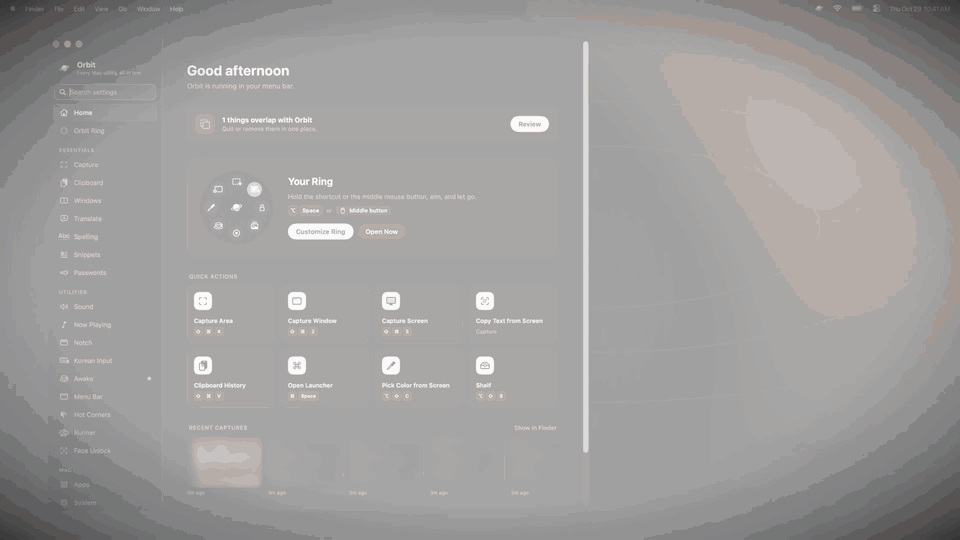
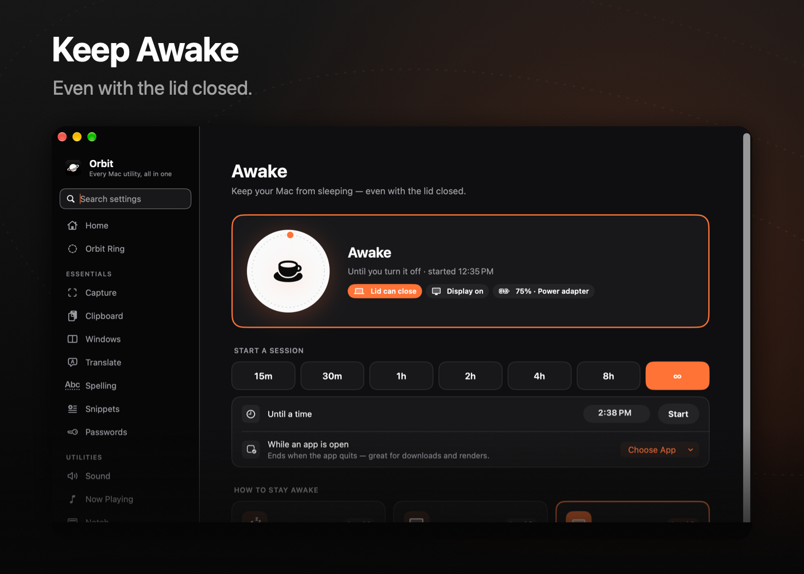
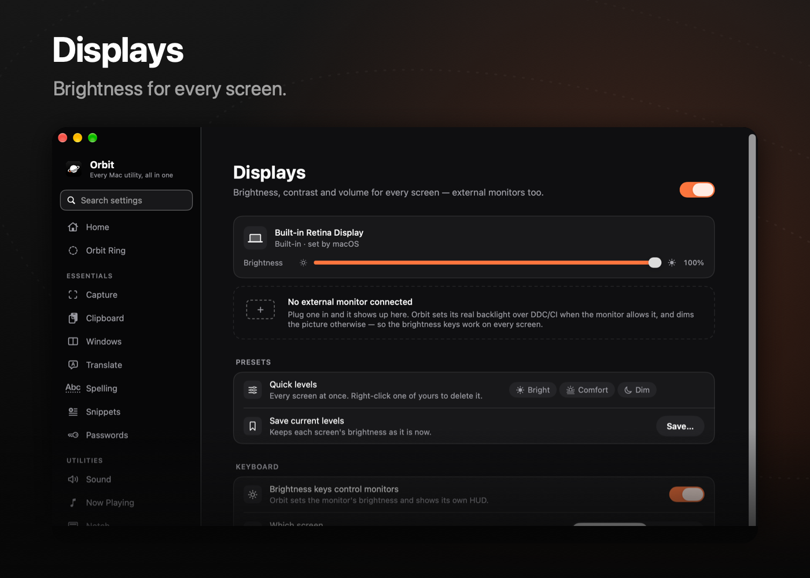

<div align="center">


# Orbit

**Every Mac utility, in one orbit.**

[](https://github.com/3x-haust/Orbit/releases/latest)
[](#requirements)
[](https://swift.org)
[](LICENSE)

[**Download**](https://github.com/3x-haust/Orbit/releases/latest) · [Features](#features) · [Build from source](#build-from-source)

**English** · [한국어](README.ko.md)

<br/>


<br/><br/>

<a href="https://github.com/3x-haust/Orbit/raw/main/docs/promo/orbit-promo-16x9-en.mp4">
  
</a>

<sub><a href="https://github.com/3x-haust/Orbit/raw/main/docs/promo/orbit-promo-16x9-en.mp4">▶︎ Watch the launch film (with sound)</a></sub>

</div>

<br/>

Orbit replaces a dock full of single-purpose menu bar apps with one fast, native app. Screenshots, clipboard history, a launcher, window snapping, translation, menu bar hiding, keep-awake, per-app volume, system monitoring and more — all reachable from one **ring** that opens around your pointer.

Black and white, with a single orange accent. Native SwiftUI + AppKit, no Electron, no accounts, no telemetry.

## Features

<table>
<tr>
<td width="50%"></td>
<td width="50%"></td>
</tr>
<tr>
<td></td>
<td></td>
</tr>
<tr>
<td></td>
<td></td>
</tr>
<tr>
<td></td>
<td></td>
</tr>
</table>

### Essentials

| | |
|---|---|
| 🪐 **Orbit Ring** | Hold a shortcut or the middle mouse button — a ring of actions opens around your pointer. 3–12 slots, presets, drag-and-drop editing. |
| 🔍 **Launcher** | ⌥Space. Apps, Orbit commands, open windows, the front app's menu commands, files, calculator, units, currency, clipboard and snippets — all from one search field. |
| 📸 **Capture** | Area, window, full screen, timed and scrolling captures (keeps up with fast scrolls). Selection keys: ⇧ lock ratio, ⌥ from center, Space to move, Tab for presets, R for the last area, and C/S/E/P/T/V/L to pick what happens. Screen recording with click highlights. An editor with arrows, text, blur, pixelate, spotlight, magnifier, ruler and color picker. Live Text and OCR. |
| 📋 **Clipboard** | Searchable history of text, images, files and colors. Single click pastes. |
| 🪟 **Windows** | Halves, thirds, quarters, center and maximize from the keyboard — aware of Stage Manager and multiple displays. |
| 🌐 **Translate** | Press ⌘C twice in any app. Google, DeepL (your key) or Apple, with automatic language detection. |
| ✓ **Spell Check** | Select text and press ⌥⇧K. Korean spelling and spacing via the Daum and Naver checkers (opt-in) or on-device Apple Intelligence; replace the selection in place. |
| ✍️ **Snippets** | Type an abbreviation, get the full text. |
| 🔐 **Passwords** | An end-to-end encrypted vault (PBKDF2 + Secret Key, AES-GCM per item), Touch ID, Watchtower and browser import. |

### Utilities

| | |
|---|---|
| 🔊 **Sound** | Per-app volume and EQ, plus a system-wide EQ. |
| 🔳 **Notch** | A living notch: music with live artwork, calendar, timers, charging and AirPods, HUDs, and a file shelf — hover or swipe to open. |
| 🎵 **Now Playing** | Controls in the notch with album art and a banner when the song changes; pauses music while a video plays. |
| ⌨️ **Input** | Automatic 한/영 switching, a scroll direction for the mouse and trackpad separately, and a keyboard-cleaning lock. |
| ☕️ **Keep Awake** | Sessions by time, until a time or while an app runs — even with the lid closed. |
| ✦ **Menu Bar** | Hides icons for real (no « chevron), brings one back on demand, plus a menu bar calendar. |
| 🔲 **Hot Corners** | Any action on any corner. |
| 🖐 **Gestures** | Three- to five-finger taps, three- and four-finger swipes, TipTap, extra mouse buttons and key combos (even ⌘⌘) run anything: Orbit actions, shortcuts, apps, links, Shortcuts or scripts — everywhere or per app. |
| 🏃 **Runner** | A tiny animated CPU meter in the menu bar. |
| 🙂 **Face Unlock** | Fill in macOS password prompts with your face. |
| 🗂 **Shelf** | A drop zone that grows out of the notch or screen edge. |

### Mac

| | |
|---|---|
| 🧩 **Apps** | Every app in a searchable grid, by category. |
| 📈 **System** | CPU, memory, GPU, disk, network, battery, temperatures and fans — tap any card for a per-process breakdown. |
| 🖥 **Displays** | Brightness and volume for external monitors over DDC, with native-style HUDs. |
| 🔋 **Battery** | Charge limit and sailing mode. |
| 🧹 **Storage** | See what takes space and clean what's safe to clean. Uninstall apps with their leftovers. |
| 🗜 **Archives** | Zip, 7z and more — names stay readable on Windows. Quick Look previews for folders and archives. |

## Install

1. Download `Orbit-<version>.dmg` (or the `.zip`) from the [latest release](https://github.com/3x-haust/Orbit/releases/latest).
2. Open it and drag **Orbit** into **Applications**.
3. Launch Orbit. It lives in the menu bar; the setup page walks you through the permissions it needs.

Orbit updates itself from GitHub Releases. You can turn automatic checks and installs on or off in **General › Updates**.

> [!NOTE]
> Releases are signed but not notarized. If macOS says it can't verify the developer, right-click Orbit.app › **Open**, or allow it in **System Settings › Privacy & Security**.

### Permissions

| Permission | Used for |
|---|---|
| Accessibility | Window management, shortcuts, the ring, snippets, menu bar |
| Screen Recording | Capture, recording, color picker, menu bar previews |
| Full Disk Access | Hiding menu bar icons for real, storage analysis |
| Camera | Face Unlock (on-device only) |
| Calendars | Events in the menu bar calendar and the notch |
| Bluetooth | AirPods and device notices in the notch |

Everything stays on your Mac. Orbit has no account, no server and no analytics; the only network requests are the translation and spell-check engines you pick and the update check.

## Requirements

- macOS 15 Sequoia or later (Liquid Glass, Apple Translation and Apple Intelligence spell check need macOS 26)
- Apple silicon or Intel (tested on M-series MacBooks)

## Build from source

```bash
brew install xcodegen
git clone https://github.com/3x-haust/Orbit.git
cd Orbit
xcodegen generate
python3 tools/i18n.py          # merges the Korean strings
open Orbit.xcodeproj
```

Set your own team in `project.yml` (`DEVELOPMENT_TEAM` and `CODE_SIGN_IDENTITY`) before building — Orbit's helper (fan control, battery) and Quick Look extension need a real signing identity.

### Project layout

```
Orbit/
├── App/            # main window, pages, settings search
├── Core/           # shortcuts, event taps, keep-awake, updater
├── Design/         # palette, components
└── Modules/        # one folder per feature (Capture, Clipboard, MenuBar, …)
FanHelper/          # privileged helper for SMC (fans, charging)
OrbitQuickLook/     # Quick Look extension for folders and archives
NowPlayingAdapter/  # media remote bridge
tools/              # i18n merge, settings index, icon rendering
```

## Contributing

Issues and pull requests are welcome. Please keep the style: native APIs, no heavy dependencies, black and white with orange used sparingly, and every string in English with a Korean translation in `tools/i18n/`.

## License

[MIT](LICENSE) © 3x-haust
